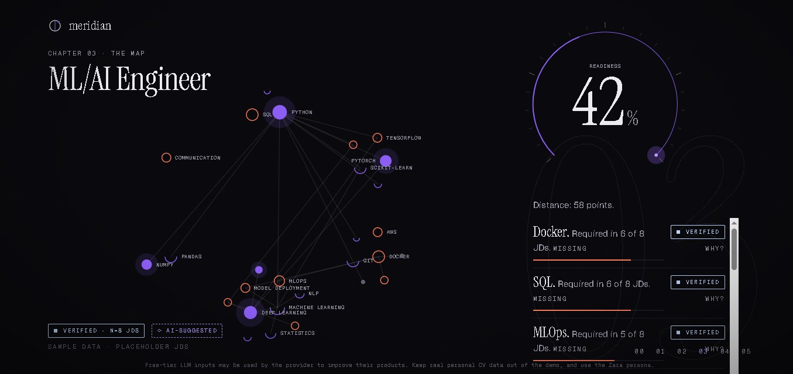

# CareerPilot AI / Meridian

CareerPilot AI is an AI-powered career planning and job-fit dashboard built with React, TypeScript, and Vite. It helps users explore career trajectories, understand skill gaps, review role-fit scoring, and track structured roadmap milestones in a visually rich interactive experience.

## Overview

This project presents a polished career guidance interface that combines:

- role and skill taxonomy exploration
- job suitability scoring
- personalized roadmap planning
- interactive visual stages and thread-based UI
- AI recommendation flow for career insights

The app is designed to help users make better career decisions by translating skills, experiences, and goals into actionable progression paths.

## Features

- Interactive career roadmap and progression views
- Skill-gap and recommendation analysis
- Job-fit scoring based on profile and requirements
- Responsive modern interface
- Vite + React + TypeScript architecture
- Tailwind styling and dynamic UI components
- LLM-backed recommendation support via server-side proxy

## Tech Stack

- React 19
- TypeScript
- Vite
- Tailwind CSS
- Zustand for state management
- Express + server proxy integration
- Vitest for testing
- PDF and data-processing utilities for career-related content

## Screenshots

### Homepage


### Main dashboard



## Project Structure

```bash
.
├── api/
├── data/
├── public/
├── scripts/
├── server/
├── screenshots/
├── src/
├── .env.example
├── .gitignore
├── .oxlintrc.json
├── NOTES.md
├── index.html
├── package.json
├── tsconfig.json
├── tsconfig.app.json
├── tsconfig.node.json
├── vercel.json
├── vite.config.ts
└── package-lock.json
```

## Getting Started

### Prerequisites

- Node.js 20+
- npm or pnpm

### Installation

```bash
git clone https://github.com/Aqibahmed12/CarrerPilot-Ai.git
cd CarrerPilot-Ai
npm install
```

### Run locally

```bash
npm run dev
```

This will start the Vite development server and the app in local mode.

### Production build

```bash
npm run build
```

### Testing

```bash
npm test
```

### Type checking

```bash
npm run typecheck
```

### Data generation

```bash
npm run data
```

### Server (LLM support)

```bash
npm run server
```

## Environment Setup

The repository includes an example environment file:

- `.env.example`

Copy it to a local `.env` file and update the required values before running the app with server-backed features.

## Notes

This project uses sample data by default for some flows. The repository notes mention that real job description data can replace sample placeholders by regenerating the data files and updating the dataset pipeline.

## Contributing

Contributions are welcome. If you want to improve the UI, job-scoring logic, data pipeline, or AI recommendation experience, please open an issue or submit a pull request.

## License

This project does not currently declare a license in the repository metadata. Please check the repository settings or ask the maintainer for licensing details before reuse or distribution.

